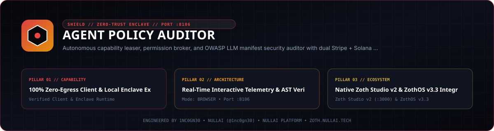
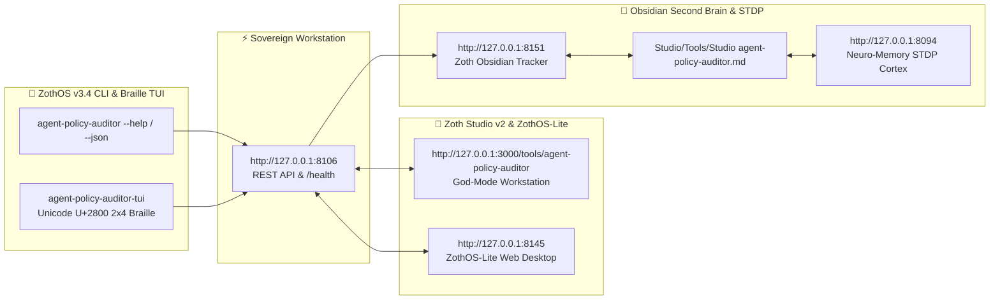

<div align="center">
  
</div>

<br />

# Agent Policy Auditor

[](pyproject.toml)
[](https://www.python.org/)
[](LICENSE)
[](https://nullai.tech)

**Autonomous Capability Leaser, Permission Broker & Manifest Security Auditor for AI Agents.**

Enforces time-bound, cryptographically signed capability leases (HMAC-SHA256) across filesystem scopes, network egress, and token budgets. Audits agent tool schemas and system prompts against OWASP Top 10 for LLMs and NIST AI RMF.

---

## ⚡ Key Architectural Capabilities

- **Zero External Pip Dependencies**: 100% Python 3.10+ standard library (`http.server`, `socket`, `sqlite3`, `hmac`, `hashlib`, `json`, `urllib.parse`, `threading`, `dataclasses`, `time`).
- **Cryptographic Capability Leasing (Port 8106)**:
  - Issues time-bound HMAC-SHA256 tokens granting granular agent scopes:
    - `FS_READ` / `FS_WRITE`: Wildcard glob path bounds (`~/workspace/**`).
    - `NET_EGRESS`: Domain allowlisting (`*.nullai.tech`).
    - `SHELL_EXEC`: Permitted command subsets.
    - `TOKEN_BUDGET`: Cumulative USD session spend caps.
  - Automatic TTL expiration and immediate emergency kill-switches (`revoke_all`).
- **Static Manifest & Prompt Security Auditor**:
  - Scores tool schemas and prompts from 0 to 100 with actionable remediation:
    - Unsandboxed shell execution detection.
    - Arbitrary unconstrained filesystem writes.
    - Hardcoded credentials and API tokens.
    - Destructive irreversible commands (`rm -rf`).
    - Unfiltered network egress.
- **Mesh Telemetry Pipeline**:
  - Forwards violations and lease grants to **Agent Flight Recorder (:8104)** and **Neuro-Memory Daemon (:8094)**.
- **100% Free & Open-Access Standard**:
  - Fully unlocked by default with zero paywalls. Optional community tips via Stripe and Solana.

---

## 🚀 Quickstart

### 1. Launch the Policy Cockpit & Broker (Port 8106)
```bash
./bin/agent-policy serve --port 8106
```
Open [http://localhost:8106](http://localhost:8106) to manage active capability leases.

### 2. Issue a Capability Lease via CLI
```bash
./bin/agent-policy lease grant --agent pantheon_01 --cap FS_WRITE --target "/tmp/*" --duration 300
```

### 3. Verify an Agent Action Against a Lease
```bash
./bin/agent-policy lease verify --lease lease_xxxxxx --cap FS_WRITE --target "/tmp/output.json"
```

### 4. Audit an Agent Tool Schema or Manifest
```bash
./bin/agent-policy audit --file agent_manifest.json
```

---

## 🧪 Testing

Run the zero-dependency test suite:
```bash
pytest -v
```

---

## ☕ 100% Free & Open-Access (Zero Paywalls)

Agent Policy Auditor is **100% free, open-access, and unlocked by default**. All capability leasers, static security rule auditors, and cryptographic certificate exporters are fully accessible with zero paywalls.

If you find this tool valuable, optional community support is welcome via:
- **☕ Buy Us a Coffee (Stripe)**: [https://buy.stripe.com/3cIfZg27PdKo2D64Ocfw40X](https://buy.stripe.com/3cIfZg27PdKo2D64Ocfw40X)
- **◎ Solana Tip Address**: `GG2eQbVh8ut1BK6j1A2tz7pSySdLpD38BgyEhGcxdXoK` (`solana:GG2eQbVh8ut1BK6j1A2tz7pSySdLpD38BgyEhGcxdXoK`)

---

*Engineered by 1nc0gn30 • NullAI ([@1nc0gn30](https://github.com/1nc0gn30)) • NullAI Sovereign Platform*

## Network exposure

The server binds to `127.0.0.1` by default. To reach it from other devices,
opt in explicitly with `--host 0.0.0.0` (or set `ZOTH_BIND_HOST=0.0.0.0`; an IP
in `HOST` is also honoured, a plain hostname is ignored) and only on a trusted
network.

Browser requests are only accepted from `localhost` / `127.0.0.1` pages:
cross-site POSTs get `403` and CORS never answers `*`, so a website you visit
can't drive this local server. CLI and agent clients are unaffected.

---

## 🏛️ ZothOS v3.4, Zoth Studio v2 & Obsidian Second Brain Ecosystem



### Cross-Surface Integration Matrix

| Surface | Endpoint / Binary | Capabilities |
| :--- | :--- | :--- |
| **Standalone Workstation** | `http://127.0.0.1:8106` | 100% Free & Open-Access Web Deck, live `/health` & REST telemetry |
| **Zoth Studio v2 Route** | `http://127.0.0.1:3000/tools/agent-policy-auditor` | Interactive God-Mode component inside Zoth Studio (`https://zoth.nullai.tech`) |
| **ZothOS v3.4 CLI & TUI** | `agent-policy-auditor` / `agent-policy-auditor-tui` | Global binary in `/usr/local/bin/` with Unicode `U+2800` Braille TUI & `--json` output |
| **ZothOS-Lite Web Desktop** | `http://127.0.0.1:8145` | Browser-native KDE-style window manager & terminal launcher |
| **Zoth Obsidian Tracker** | `http://127.0.0.1:8151` | Interactive Obsidian Second Brain vault explorer (`~/Documents/Obsidian Vault/Studio/Tools/Studio agent-policy-auditor.md`) |
| **Neuro-Memory STDP Cortex** | `http://127.0.0.1:8094` | 3-Factor STDP synaptic memory daemon & 21-tool MCP server |

```bash
# Inspect CLI & Unicode U+2800 Braille TUI on ZothOS v3.4
agent-policy-auditor --help
agent-policy-auditor-tui --status
agent-policy-auditor-tui --json

# Verify Second Brain Vault & 12-Step Verification Gallery on :8151
zoth-obsidian-tracker --verify
```

